# doomscroll

> a small neural network that learns to rank a short-video feed, plus a simulator that checks whether
> the feed is actually *good* — not just popular.

this repo takes ~19.7 million real user interactions from **kuaisar-v2**, turns them into clean,
leak-free features, trains a compact cpu model (~123k parameters) to predict engagement, and then
drops that model into a closed-loop user simulator to test whole feed policies. everything here runs
on a laptop cpu, no gpu.

**start here:** the end-to-end story lives in [`demo.ipynb`](demo.ipynb) — it explains every step in
plain english and runs top to bottom. this readme is the written companion.

---

## the numbers at a glance

| thing | value |
|---|---|
| data | 19.66m events · 25,877 users · 6.89m items · 19.1 days · 38 categories |
| model | "wide" tasetnet, **122,773 parameters**, cpu, ~45 s/epoch |
| best val ndcg@10 | **0.5143** (was 0.5006 in the first short pilot) |
| test ndcg@10 | **0.5332** vs popularity 0.4976 → **+0.0356** (95% ci [+0.0327, +0.0384], excludes 0) |
| objective | masked bce + a **lambdarank** ranking term |
| policy ladder | evolves to **59% of the personalized-oracle gap**, every rung ci-checked |

(mini glossary: **ndcg** is a ranking score from 0 to 1 — 0.5 is roughly random order, 1.0 is a
perfect order. **tier** is the graded engagement label, 0 = scrolled past … 4 = strong signal.
**cold start** = a video or user the model has never seen before.)

---

## the data

the raw logs are impressions: *this user was shown this video at this time*. each row already carries
engineered features and an engagement label. we split **by time**, so `val` happens after `train` and
`test` after `val` — that's how you honestly test whether a model generalises to the future.

```text
raw 19.66m events  →  cleaned 19.62m (99.75% kept, 48,257 exact duplicates dropped)
                   →  modelled after a 5/3 k-core filter (only users/items with enough history)
                   →  train 2.61m / val 1.96m / test 1.96m   (strictly temporal, no leakage)
```

| split | impressions | users | videos | search % | 
|---|---|---|---|---|
| train | 2,612,256 | 13,269 | 568,189 | 11.2% |
| val   | 1,959,189 | — | — | ~11% |
| test  | 1,959,194 | — | — | ~11% |

why a k-core filter? because a user seen once and a video seen once carry almost no learnable signal.
dropping them removes noise (and 81% of the long-tail items) so the model can focus on patterns that
repeat.

---

## what the data looks like (the eda)

before modelling anything we looked hard at the data. every plot below lives in
[`eda/figures/`](eda/figures/) — 22 committed pngs, all traceable to the notebooks in [`eda/`](eda/).

### 1. clicks are cheap; real intent is rare

the label is graded, not binary. most impressions are weak (a scroll-past) and only a small slice is
strong (a like, follow or forward). that imbalance is the single most important fact about the data.

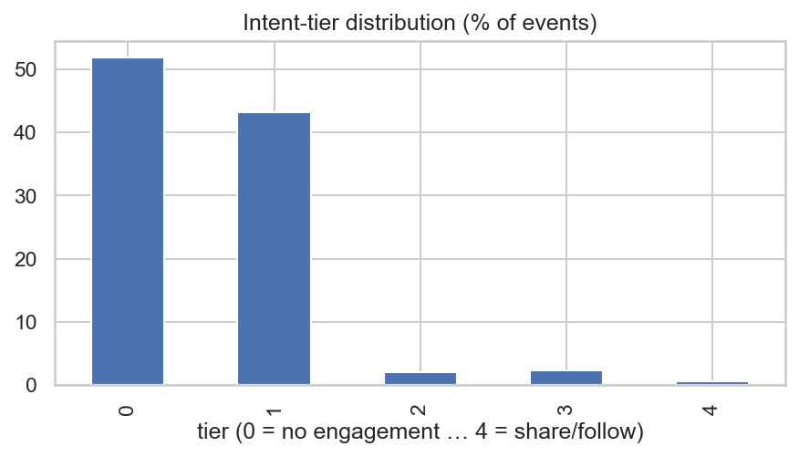

- tier 0 (no engagement) **~48%**, tier 1 (a click) **~46%**, then it collapses: tier 2 ~3%, tier 3
  ~2.5%, tier 4 **~0.6%**.
- per-action rates are just as lopsided: click ~50%, like ~3%, follow ~0.4%, forward ~0.3%.

so if you label everything "positive vs negative", you dump 95% noise and 5% gold into one bucket. we
instead rank on the **tier** with graded gains, and the metric (ndcg) rewards putting the strong
engagements at the top.

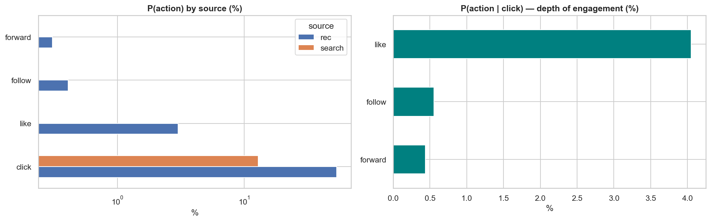
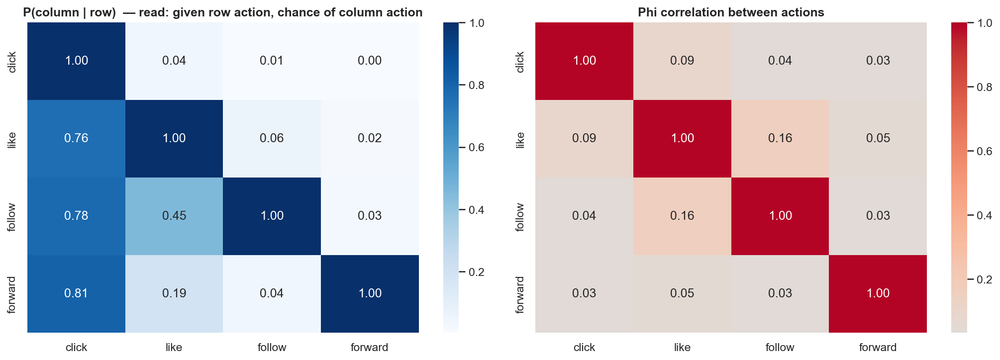

likes barely co-occur with follows/forwards — they're different intents, not one scale.

### 2. no single feature wins; habit + affinity does

we checked how predictive each feature is on its own. nothing is a silver bullet, but *how this user
usually behaves* and *how much they liked this category before* carry the most signal.

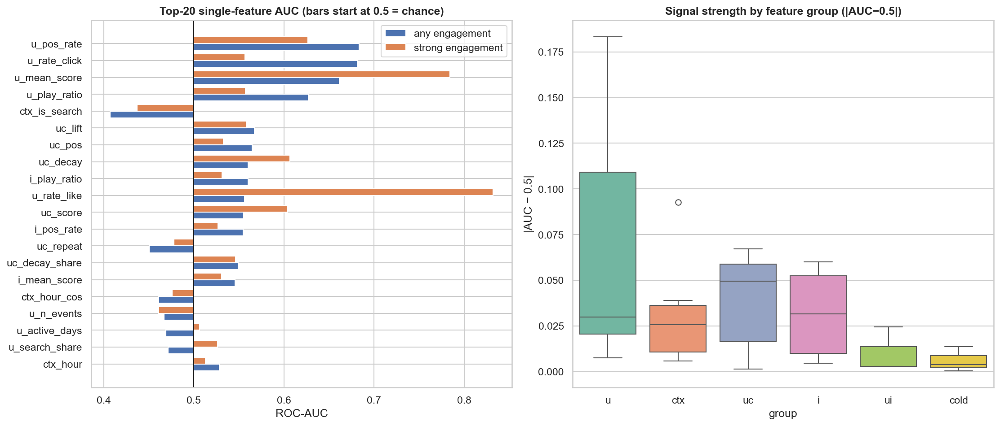

- best single features: `u_pos_rate` ~0.68 roc-auc, `u_mean_score` ~0.66, `u_play_ratio` ~0.63.
- user features > user-category > item > context. no lone winner → the model combines many.

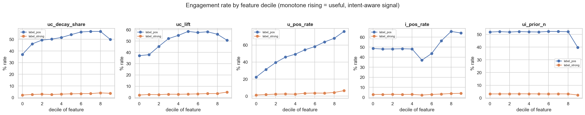
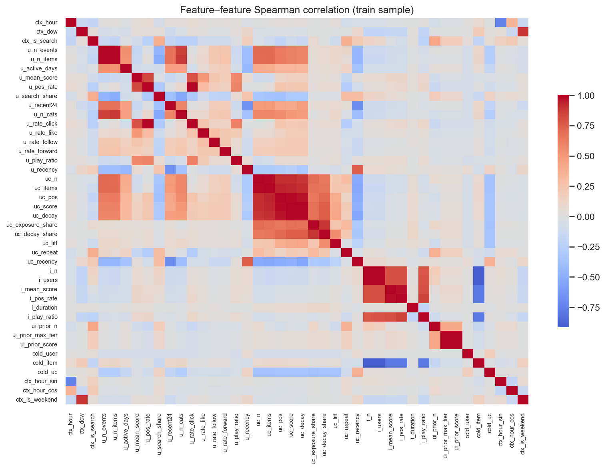

### 3. activity is brutally unequal — personalise or die

a few users scroll a *lot*. a model that treats everyone the same will be wrong for almost everyone.

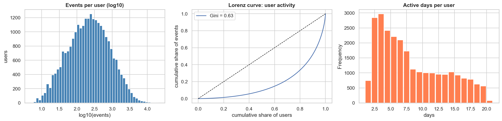

- median **223 events per user**, but the distribution is a long tail (gini ~0.63).
- top 1% of users generate ~12% of events; top 10% ~48%.

that's why almost every feature is **user-normalised** (each user's own click rate, their own mean
score, their own affinity) instead of a global average.

### 4. popularity is a coverage hack, not a ranker

the most-shown videos aren't the best ones.

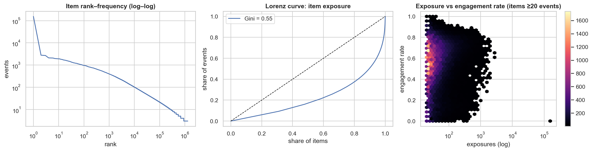

- exposure is a log-log long tail (gini ~0.55): top 1% of videos take ~20% of impressions.
- but log-exposure vs engagement-rate correlation is only ~0.13 — being popular barely tells you if a
  video will engage.

so popularity is a fine *baseline* and a terrible *policy*. the model uses quality priors per video
(`i_pos_rate`, `i_mean_score`, `i_play_ratio`) plus a category fallback for cold videos.

### 5. timing matters

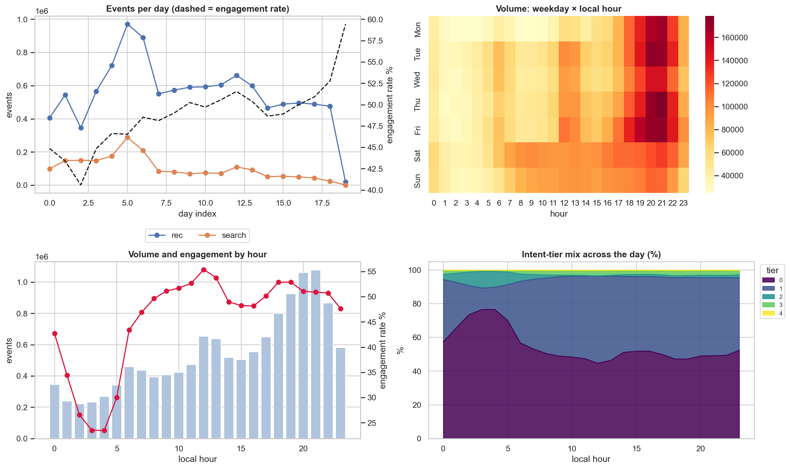

- volume peaks around 20–21h; engagement peaks around midday and drops off a cliff at 3–4am.
- so we feed the model the hour (as a sine/cosine pair) — noon ≠ midnight.

### 6. search is a cheat code for the feed

search is a small slice of traffic but a strong signal, and it behaves on a different clock from the
feed.

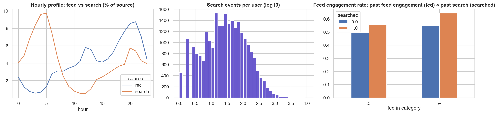

- search ≈ 15% of events, but ~97% of users search at least once.
- feed engagement is **+6 to +10 points** higher when the user recently searched the same category.

one catch: search logs *clicks only*. so for search rows, `like/follow/forward` are **unobserved**, not
"disliked". we **mask** those instead of pretending they're negatives — a classic and costly ranking
mistake we avoid.

### 7. watch-time is the dense signal

discrete actions are sparse (~3% likes) but the watch fraction is available on most rows.

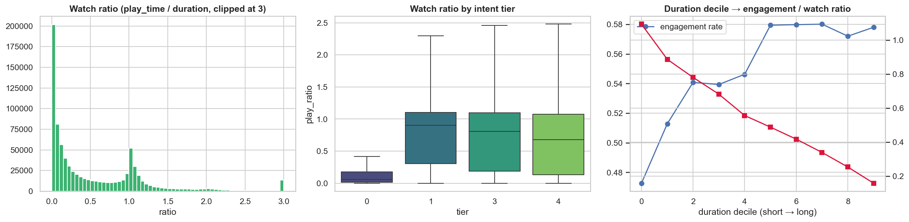

- watch fraction is bimodal: a spike near 0 (instant skip) and a spike near 1 (finished).
- tier-0 rows watch ~0; tier-1+ rows watch ~0.7–0.9.

### 8. novelty or death

showing the same thing again kills engagement fast.

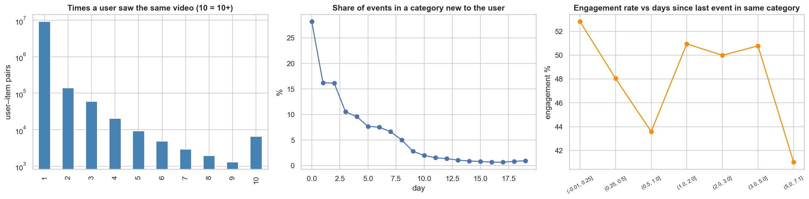

- engagement drops as a user sees more of the same category: 0 priors ~52% → 1 prior ~15% → 3+ ~4%.
- so we down-weight seen items and use exponential recency (3-day half-life, 7-day lookback).

### 9. categories are broad but shallow

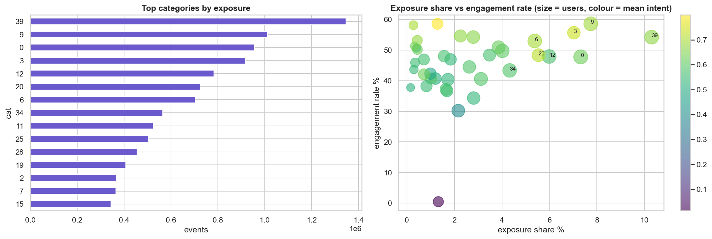

- 38 first-level categories; users engage a **median of ~20** of them.
- entropy ~4 bits — people are exploratory, so a good feed both exploits *and* diversifies.

### 10. evaluation is hostile by design

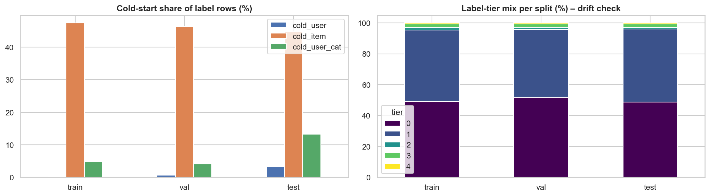
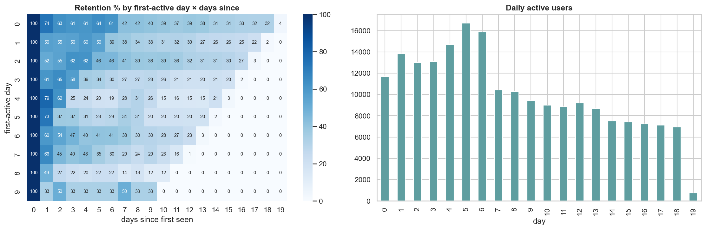

cold **videos** (unseen within a split) are the hard part — no memorising item ids; the model leans on
category affinity + quality priors + exploration. user cohorts and label mixes stay stable across the
window, so there's no target drift.

> full gallery: **22 pngs in [`eda/figures/`](eda/figures/)**. the notebooks
> [`eda/01_load_and_clean.ipynb`](eda/01_load_and_clean.ipynb),
> [`02_preprocess_and_features.ipynb`](eda/02_preprocess_and_features.ipynb),
> [`03_eda.ipynb`](eda/03_eda.ipynb) are the source of truth.

---

## the task and the labels

the model predicts **five actions**: `click`, `like`, `follow`, `forward`, `watch`. two subtleties:

- **masking.** not every action is logged everywhere (search = clicks only). we ignore unobserved
  labels rather than calling them negatives.
- **ranking, not regression.** what matters is *order*. the final metric is ndcg@k over each user's
  impressions, with gains `[0,1,2,3,4]` derived from the tier, so a strong engagement counts far more
  than a weak one.

---

## the model

one architecture — the "wide" `tastenet` — and nothing else. it's a small multi-tower network:

```text
user tower    9  features  → 128 → 64
video tower   5  features  (+ 24-dim category embedding) → 128 → 64
pair tower    13 features  → 64
interaction   element-wise  user ⊙ video        ← lets the model learn "this user likes this, why"
fusion        256 → 128 → 5 logits               ← one logit per action
```

**122,773 parameters.** that's the whole model — small enough to train on a cpu in minutes, big enough
to matter. the element-wise interaction is the key idea: it lets the network reason about *specific*
user–video combinations, not just each side separately.

---

## training

we train with a **hybrid objective**:

```text
loss = masked bce (predict each action's probability, ignore unlogged actions)
     + rank_weight · lambdarank (reward putting higher-tier videos above lower-tier ones)
```

the ranking term is what moved the needle. ablation (same architecture/data/seed, only the objective
changes) — full data, paired bootstrap vs the plain-bce reference:

| variant | change | val ndcg@10 | delta vs ref (95% ci) |
|---|---|---|---|
| `lambdarank` | `loss=lambdarank` | **0.5119** | **+0.0158 [+0.0132, +0.0184]** |
| `no_weighting` | drop sqrt positive-weighting | 0.5002 | +0.0041 [+0.0021, +0.0062] |
| `cap5` | cap positive weight at 5 | 0.4974 | +0.0013 [-0.0003, +0.0029] |
| `masked_bce` | reference | 0.4961 | — |
| `uncertainty` | learn per-head weights | 0.4945 | -0.0016 [-0.0033, -0.0001] |
| `lr 5e-3` | higher learning rate | 0.4932 | -0.0029 [-0.0049, -0.0011] |

the shipped model trains with lambdarank for **up to 22 epochs** (early-stopped at 16; best epoch 11).
epoch by epoch:

| epoch | train obj | val ndcg@10 | val ndcg@20 | | epoch | train obj | val ndcg@10 | val ndcg@20 |
|---|---|---|---|---|---|---|---|---|
| 1 | 0.842 | 0.4989 | 0.5523 | | 9 | 0.803 | 0.5100 | 0.5623 |
| 2 | 0.816 | 0.5027 | 0.5548 | | 10 | 0.801 | 0.5107 | 0.5627 |
| 3 | 0.814 | 0.5064 | 0.5580 | | **11 ★** | 0.801 | **0.5143** | 0.5656 |
| 4 | 0.809 | 0.5057 | 0.5582 | | 12 | 0.797 | 0.5126 | 0.5642 |
| 5 | 0.807 | 0.5076 | 0.5596 | | 13 | 0.797 | 0.5099 | 0.5623 |
| 6 | 0.808 | 0.5072 | 0.5602 | | 14 | 0.792 | 0.5114 | 0.5633 |
| 7 | 0.807 | 0.5093 | 0.5608 | | 15 | 0.789 | 0.5119 | 0.5637 |
| 8 | 0.806 | 0.5111 | 0.5631 | | 16 | 0.788 | 0.5136 | 0.5653 |

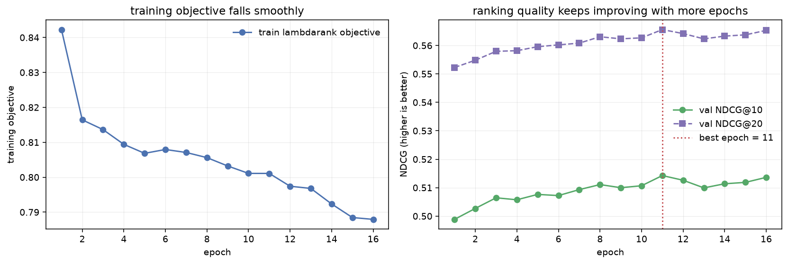

two notes an intermediate reader will appreciate:

- the val **bce** column isn't shown because a *ranking* objective is allowed to sacrifice probability
  calibration for order — bce can rise while ndcg improves. ndcg is the number that decides.
- more epochs genuinely helped: the first 6-epoch pilot reached 0.5006; the longer run reaches
  **0.5143**.

---

## how well does it rank?

we score the model once on validation and once on test and compare with two no-ml baselines.

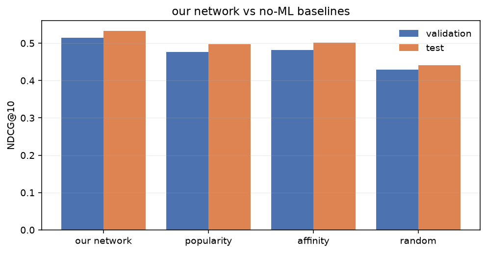

| ranking method | val ndcg@10 | test ndcg@10 |
|---|---|---|
| **our network (lambdarank)** | **0.5143** | **0.5332** |
| personal affinity | 0.4822 | 0.5013 |
| popularity | 0.4766 | 0.4976 |
| random | 0.4293 | 0.4407 |

paired bootstrap on the test split: our network beats popularity by **+0.0356 ndcg@10**, 95% ci
**[+0.0327, +0.0384]** — the interval excludes zero, so this is a real improvement, not luck. it also
beats personalized affinity, and it does so with a **123k-parameter** model trained on a cpu.

---

## from a ranker to a whole feed policy (the simulator)

a good ranking score is necessary but not sufficient — a real feed also needs **diversity** (don't loop
the same topic) and **retention** (keep people around). to test the full system we plug the network
into a calibrated **closed-loop user simulator** (10,000 bots × 7 days) and compare policies on a
"well-being" score (iwe), with the same random draws replayed per policy (paired comparison).

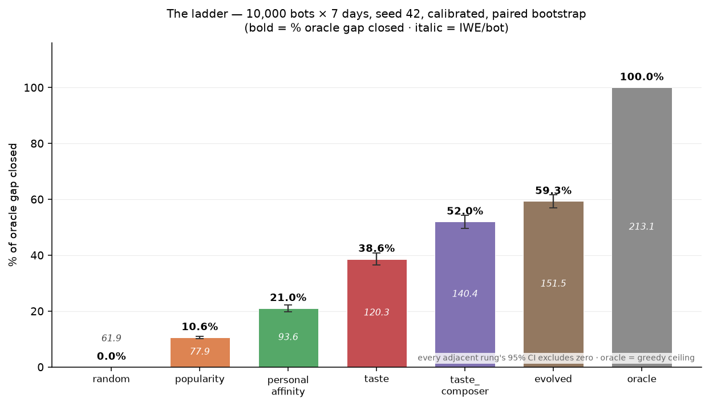

| policy | iwe / bot | oracle gap closed | promotion (95% ci) |
|---|---|---|---|
| random | 61.86 | 0.00 | baseline |
| popularity | 77.87 | 0.11 | +16.0 [+15.3, +16.7] |
| personal affinity | 93.64 | 0.21 | +15.8 [+14.1, +17.4] |
| taste (the learned ranker) | 120.26 | 0.39 | +26.6 [+24.0, +29.3] |
| taste + composer | 140.44 | 0.52 | +20.2 [+18.9, +21.5] |
| **evolved (es over 18 knobs)** | **151.53** | **0.59** | **+11.1 [+9.9, +12.4]** |
| oracle (greedy ceiling) | 213.10 | 1.00 | — |

every adjacent rung's ci excludes zero, so each step is a real gain. and engagement doesn't come by
killing diversity: category entropy goes *up* (3.08 → 3.33 bits) and repeat-exposure goes *down*
(0.6% → 0.4%).

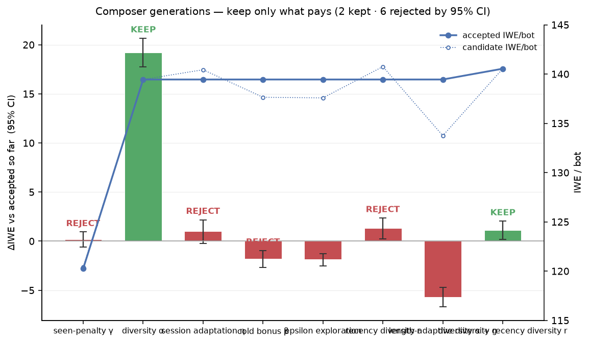
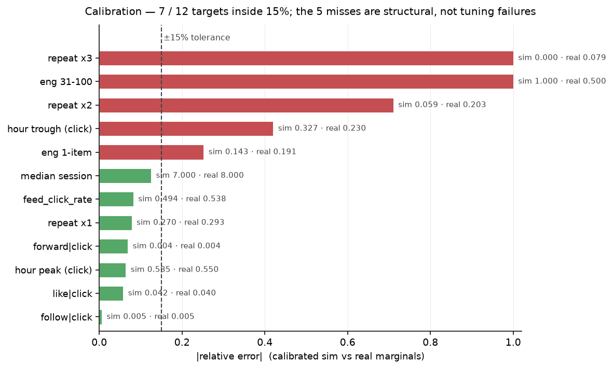
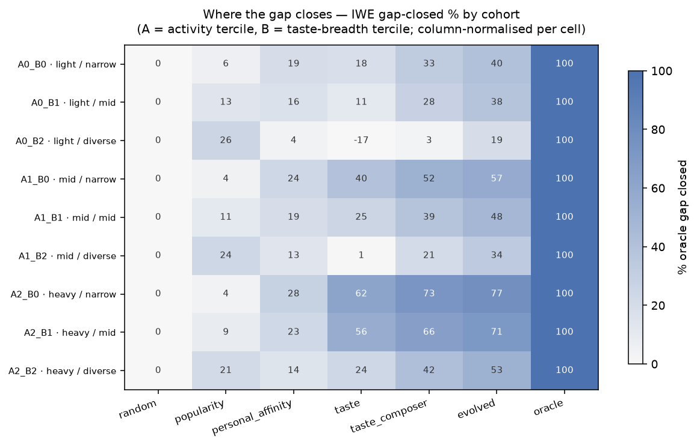
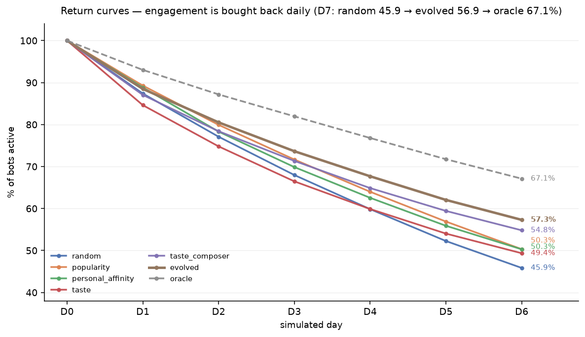

a simulator is only useful if it resembles reality — it's calibrated to real marginals and **7 of 12**
targets land inside the 15% tolerance band (the 5 misses are honest model-form limits, documented in
[`notes/calibration.md`](notes/calibration.md)).

---

## watching one session

finally, we roll the trained ranker through the simulator and watch a single session unfold swipe by
swipe — the video being watched, the next recommendation (**with its topic**), and the reaction.

```text
[01] watching : — (session start)
     next up  : real estate · clip #966780     reacted : click, watch 87%   (tier 1)
[02] watching : real estate · clip #966780
     next up  : real estate · clip #6376331    reacted : scroll past        (tier 0)
[03] watching : real estate · clip #6376331
     next up  : real estate · clip #3902995    reacted : click, forward, watch 85%  (tier 4)
...
```

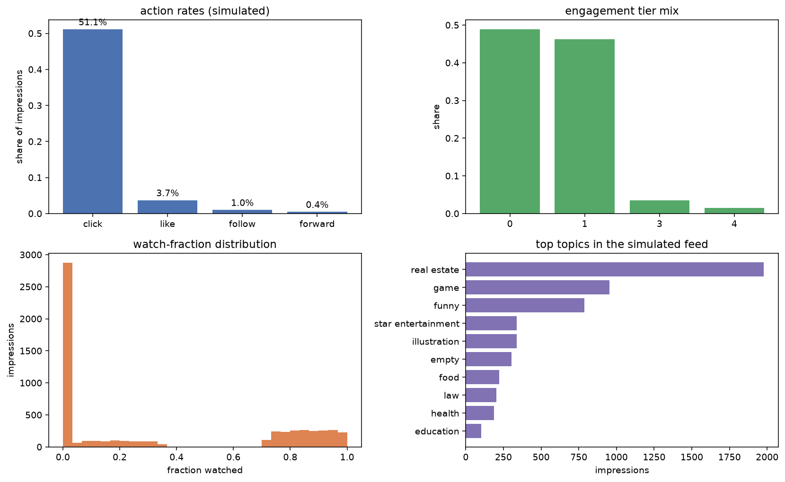
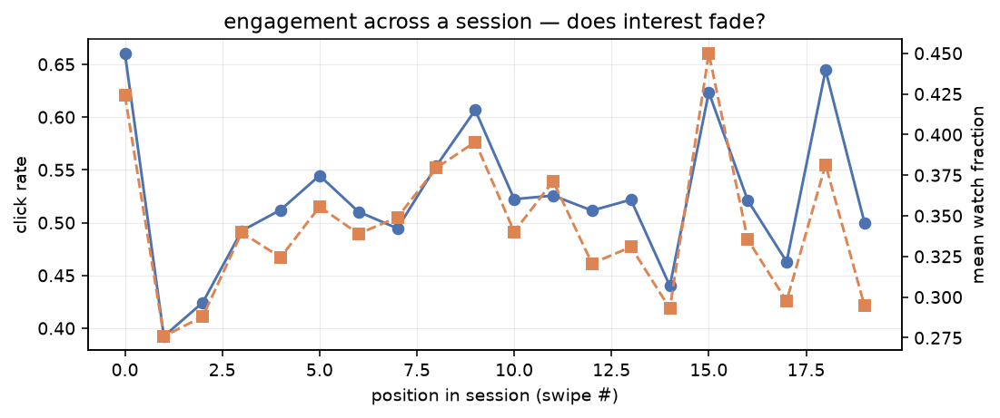

the summary metrics for the simulated population (clicks, likes, watch fraction, engagement mix) are
all in [`demo.ipynb`](demo.ipynb) section 10. everything in this section is **simulated** — it
illustrates behaviour and is *not* a causal claim about real people.

---

## what we tried that didn't work (kept on purpose)

honest research keeps the failures. each was measured with a ci, not hand-waved:

| idea | measured fate |
|---|---|
| seen-penalty γ | −0.01 [−0.66, +0.64] — redundant with within-session dedup |
| cold-item bonus β | −1.04 [−2.21, +0.13] — cold start needs a real exploration process |
| ε-greedy exploration | −2.34 [−3.00, −1.67], plus a worse repeat-exposure guardrail |
| length-adaptive diversity alone | −5.70 [−6.70, −4.69] — collapses iwe |
| raw capacity (wide / deep / cross) | ≈ neutral under bce (−0.001 to −0.002): the **objective**, not size, helps |
| learned per-head loss weighting | −0.0016 [−0.0033, −0.0001] |

---

## run it yourself

```bash
cd recommender-engine
P=~/miniconda3/envs/picograd/bin/python
$P -m pytest -q                                     # 35 fast tests
$P run_offline.py --fast                            # sanity: full pipeline + graded ndcg
$P run_train.py --variant wide --loss lambdarank    # the shipped network (long run, cpu)
$P run_swarm.py                                     # the policy ladder (~2 min)
$P run_generations.py                               # composer generations
$P run_evolve.py                                    # (1+λ)-es over 18 knobs
$P -m feed.plotting                                 # policy figures -> ../eda/figures/
$P build_demo.py                                    # regenerate demo.ipynb
python -m nbconvert --to notebook --execute ../demo.ipynb --output ../demo.ipynb
```

pretrained checkpoints are published in
[`recommender-engine/weights/`](recommender-engine/weights/) (the shipped ranker + the sim ranker).

---

## repo layout

```text
doomscroll/
  demo.ipynb                      ← the end-to-end, executed notebook (start here)
  eda/
    01_load_and_clean.ipynb       ← raw → canonical event table
    02_preprocess_and_features.ipynb ← tiers, temporal splits, 43 features
    03_eda.ipynb                  ← behavioural analysis, all figures
    figures/                      ← every png: 22 eda + 5 policy + diagnostics + training/sim
  recommender-engine/
    feed/                         ← world, swarm, policies, composer, evolve, model, losses, train
    run_*.py                      ← drivers (offline, train, improve, swarm, generations, evolve, losses)
    weights/                      ← published cpu checkpoints
    config/  tests/  artifacts/
  notes/                          ← per-phase write-ups + results/*.json
  status.md                       ← phase-by-phase build log, done vs left
```

---

## limitations (read these)

- engagement labels are **observational**; `watch` is only a proxy for satisfaction.
- search rows log clicks only — zeros for like/follow/forward mean *unlogged*, not *negative*.
- 19 days supports short-term habit modelling, not long-term churn.
- the simulator is **hand-designed and calibrated to marginals only** (7/12) — sections about the
  ladder and sessions are **relative and illustrative**, not causal claims about real users.
- the k-core filter drops ~81% of items from training; serving the tail needs the cold-start path.
- univariate auc shows feature *viability*, not multivariate proof — interactions come from the model.

---

## license & provenance

mit — see `LICENSE`. data: kuaisar-v2, research use, never committed (git-ignored). notebooks are the
source of truth for the data layer; the engine is code-first (`feed/` + configs + tests).
