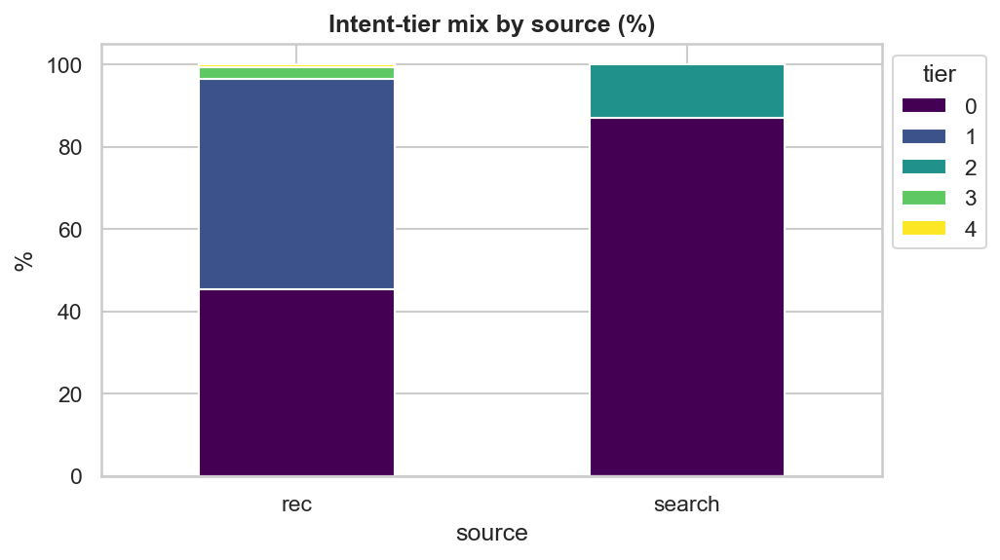
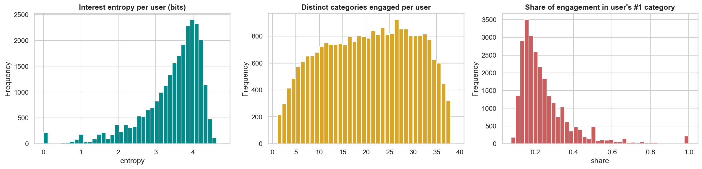
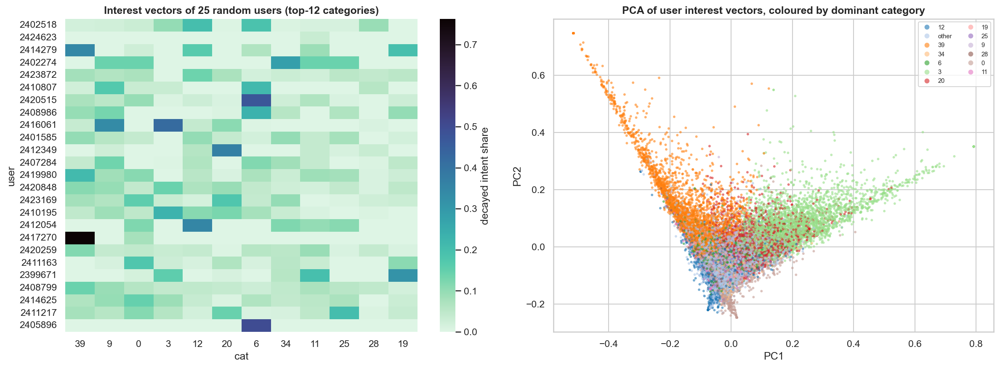
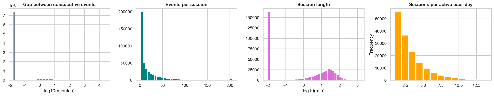
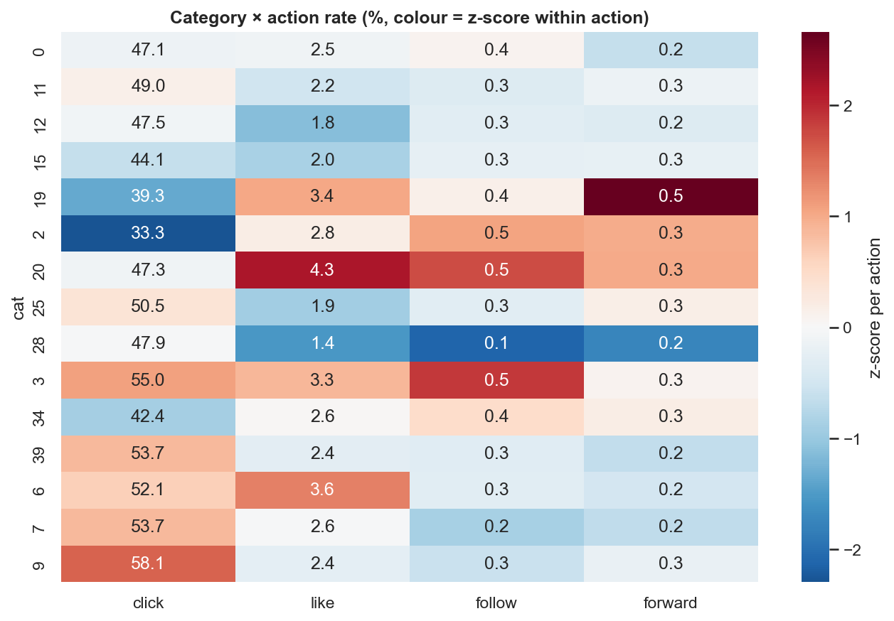
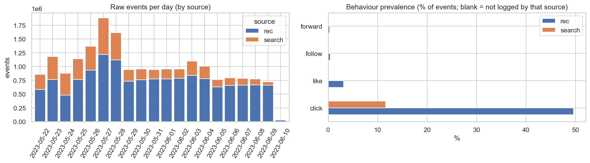
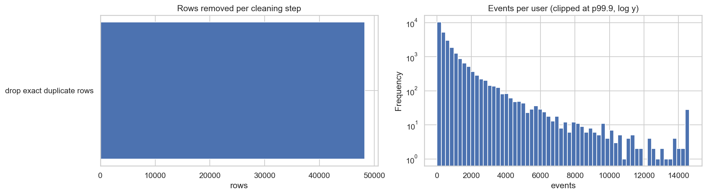
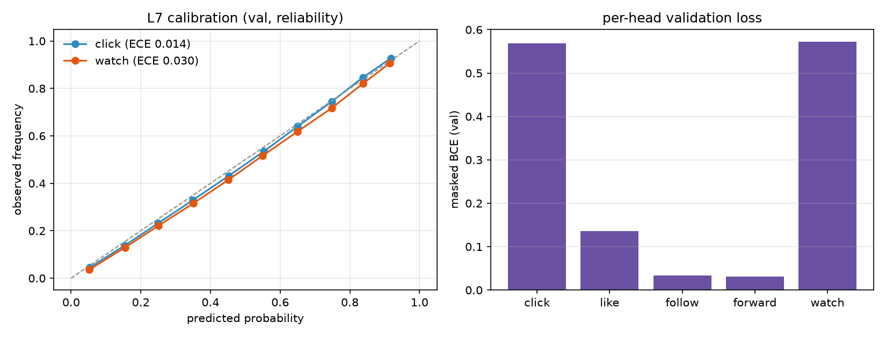

# doomscroll

> we taught a 123k-parameter neural network to run a short-video feed — and then built a fake world
> of 10,000 users to check whether the feed is actually *good*, not just *popular*.

this repo takes ~19.7 million real interactions from **kuaisar-v2**, turns them into leak-free
features, trains a small cpu model to predict engagement, and drops that model into a calibrated
user simulator to test whole feed policies end to end. no gpu. no cloud. a laptop and a lot of
patience.

**if you read one thing, read [`demo.ipynb`](demo.ipynb).** it walks the whole thing in plain
english, runs top to bottom, and shows every graph inline. this readme is the director's commentary.

---

## the numbers, up front

| | |
|---|---|
| data | 19.66m events · 25,877 users · 6.89m items · 19.1 days · 38 categories |
| model | "wide" tasetnet · **122,773 parameters** · cpu · ~45 s/epoch |
| val ndcg@10 | **0.5143** (the first 6-epoch pilot managed 0.5006) |
| test ndcg@10 | **0.5332** — popularity scores 0.4976, so **+0.0356** (95% ci [+0.0327, +0.0384]) |
| objective | masked bce **+ a lambdarank ranking term** |
| feed policy | evolves to **59% of the personalized-oracle gap**, every rung ci-checked |

tiny glossary, so nothing below is a mystery: **ndcg** is a 0-to-1 ranking score (0.5 ≈ random order,
1.0 = perfect). **tier** is the graded engagement label (0 = scrolled past, 4 = strong signal).
**cold start** = a user or video the model has never seen. **ci** = confidence interval — if it
excludes zero, the effect is probably real.

---

## the data

an impression is one row: *this user was shown this video at this time*. we split **by time**, so
`train` is the past, `val` is the near future, `test` is the further future. that's the only honest
way to ask "does this generalise to tomorrow?"

```text
raw 19.66m events  →  cleaned 19.62m  (99.75% kept, 48,257 exact dups yeeted)
                   →  modelled after a 5/3 k-core filter
                   →  train 2.61m / val 1.96m / test 1.96m   (strictly temporal, zero leakage)
```

| split | impressions | users | videos | search % |
|---|---|---|---|---|
| train | 2,612,256 | 13,269 | 568,189 | 11.2% |
| val   | 1,959,189 | — | — | ~11% |
| test  | 1,959,194 | — | — | ~11% |

why throw away the tail with a k-core filter? because a user seen once and a video seen once teach you
nothing. we drop ~81% of items to keep the signal, and then — spoiler — spend the rest of the project
handling the cold items we just dropped, because the tail you filter is the tail you have to serve.

---

## the eda (where the personality actually lives)

before a single weight got trained we stared at these numbers until they told us what to build. every
plot below is committed in [`eda/figures/`](eda/figures/), generated by the notebooks in
[`eda/`](eda/).

### 1. clicks are cheap. intent is expensive.

the label is graded, and the distribution is *brutal*.


- tier 0 (no engagement) **~48%**, tier 1 (just a click) **~46%** — then the cliff: tier 2 ~3%,
  tier 3 ~2.5%, tier 4 **~0.6%**.
- per-action rates are worse: click ~50%, like ~3%, follow ~0.4%, forward ~0.3%.

so binary "positive vs negative" labelling would shove 95% noise and 5% gold into one bucket and call
it a day. we don't. we rank on **tier** with graded gains `[0,1,2,3,4]` so a follow counts ~5x a
click, and we grade with ndcg.


likes and follows barely overlap — they're different *intents*, not points on one dial.



### 2. watch-time is the signal that shows up when actions don't

~3% likes is a desert. the watch fraction is a rainforest.


- bimodal: a spike near 0 (instant skip) and a spike near 1.0 (watched to the end).
- tier-0 rows watch ~0; tier-1+ rows watch ~0.7–0.9.

### 3. no single feature wins. habit + affinity does.

we asked every feature "how far can you carry this alone?" (roc-auc; 0.5 = a coin toss).


- best solo acts: `u_pos_rate` ~0.68, `u_mean_score` ~0.66, `u_play_ratio` ~0.63.
- the ranking of *groups* is what mattered: **user > user-category > item > context**. no lone hero →
  the model blends all of them.


no two features are perfectly correlated — good, because redundant features are dead weight.

### 4. activity is brutally unequal. personalise or die.

a few people scroll like it's their job. a global model will be wrong for basically everyone.


- median **223 events/user**, but the distribution drags a long tail (gini ~0.63).
- top 1% of users → ~12% of events; top 10% → ~48%.

that single fact is why nearly every feature is **user-normalised** (this user's own click rate, their
own mean score, their own affinity) instead of some global average.




### 5. popularity is a lie (well, a coverage hack)

the most-shown videos are not the best ones. shocking, we know.


- exposure is a log-log long tail: top 1% of videos hog ~20% of impressions.
- but log-exposure vs engagement-rate correlation is only ~0.13 — popularity barely predicts
  engagement.

**translation:** popularity is a fine *baseline* and a garbage *policy*. the model leans on per-video
quality priors (`i_pos_rate`, `i_mean_score`, `i_play_ratio`) and a category fallback for cold videos.



### 6. timing is free signal


volume peaks around 20–21h, engagement peaks at midday, and both fall off a cliff at 3–4am. so the
model eats the hour (as a sin/cos pair) — noon ≠ midnight.



sessions are short and front-loaded: the first few impressions decide whether the session lives.

### 7. search is the cheat code

search is a sliver of traffic but a firehose of signal, on a totally different clock from the feed.


- search ≈ 15% of events, yet ~97% of users search at least once.
- feed engagement is **+6 to +10 points** higher when the user recently searched the same category.

one trap: search logs **clicks only**. for search rows, `like/follow/forward` are **unobserved**, not
"disliked". we **mask** them instead of feeding the model fake negatives — a classic, expensive
ranking mistake avoided.

### 8. novelty or death

show someone the same thing twice and watch engagement faceplant.


- engagement vs repeat priors: 0 priors ~52% → 1 prior ~15% → 3+ priors ~4%.
- so we down-weight seen items and use exponential recency (3-day half-life, 7-day lookback).


cold **videos** are the real boss fight — you can't memorise item ids, so the model has to reason with
category affinity + quality priors + exploration.

### 9. categories are broad, not deep


38 topics, and users dabble in a **median of ~20** of them (entropy ~4 bits). people are explorers. a
good feed exploits *and* diversifies.



### 10. the cleanup receipt




> the whole gallery — **22 pngs** — lives in [`eda/figures/`](eda/figures/). the notebooks are the
> source of truth: [`01_load_and_clean`](eda/01_load_and_clean.ipynb),
> [`02_preprocess_and_features`](eda/02_preprocess_and_features.ipynb),
> [`03_eda`](eda/03_eda.ipynb).

---

## the task

predict **five actions**: `click`, `like`, `follow`, `forward`, `watch`. two things that trip everyone
up:

- **masking.** not every action is logged everywhere (search = clicks only). unobserved ≠ negative.
  we ignore those labels instead of inventing dislikes.
- **order, not numbers.** what matters is *which video ranks higher*, so the metric is ndcg@k per user
  with tier-derived gains.

---

## the model

one architecture. the "wide" `tastenet`. no leftovers, no pilot net, no zoo of variants.

```text
user tower    9  features                          → 128 → 64
video tower   5  features  (+ 24-dim category emb) → 128 → 64
pair tower    13 features                          → 64
interaction   (user ⊙ video) element-wise           ← "this user likes this video, and here's why"
fusion        256 → 128 → 5 logits                  ← one logit per action
```

**122,773 parameters.** small enough to train on a cpu in minutes, big enough to beat popularity by a
mile. the element-wise interaction is the whole trick — it lets the network reason about *specific*
user–video pairings instead of each side in isolation.

---

## training

the objective is half recalibrated, half bloodthirsty:

```text
loss = masked bce   (predict each action's probability, ignore unlogged ones)
     + rank_weight · lambdarank   (reward putting higher-tier videos above lower-tier ones)
```

the ranking term is what moved the needle. ablation — same net, same data, same seed, only the
objective changes (full data, paired bootstrap vs plain-bce):

| variant | change | val ndcg@10 | delta vs ref (95% ci) |
|---|---|---|---|
| `lambdarank` | `loss=lambdarank` | **0.5119** | **+0.0158 [+0.0132, +0.0184]** |
| `no_weighting` | drop sqrt positive-weighting | 0.5002 | +0.0041 [+0.0021, +0.0062] |
| `cap5` | cap positive weight at 5 | 0.4974 | +0.0013 [-0.0003, +0.0029] |
| `masked_bce` | the reference | 0.4961 | — |
| `uncertainty` | let the model learn per-head weights | 0.4945 | -0.0016 [-0.0033, -0.0001] |
| `lr 5e-3` | crank the learning rate | 0.4932 | -0.0029 [-0.0049, -0.0011] |

the shipped model trains with lambdarank for **up to 22 epochs** (early-stopped at 16, best epoch 11):

| epoch | train obj | val ndcg@10 | val ndcg@20 | | epoch | train obj | val ndcg@10 | val ndcg@20 |
|---|---|---|---|---|---|---|---|---|
| 1 | 0.842 | 0.4989 | 0.5523 | | 9 | 0.803 | 0.5100 | 0.5623 |
| 2 | 0.816 | 0.5027 | 0.5548 | | 10 | 0.801 | 0.5107 | 0.5627 |
| 3 | 0.814 | 0.5064 | 0.5580 | | **11 ★** | 0.801 | **0.5143** | 0.5656 |
| 4 | 0.809 | 0.5057 | 0.5582 | | 12 | 0.797 | 0.5126 | 0.5642 |
| 5 | 0.807 | 0.5076 | 0.5596 | | 13 | 0.797 | 0.5099 | 0.5623 |
| 6 | 0.808 | 0.5072 | 0.5602 | | 14 | 0.792 | 0.5114 | 0.5633 |
| 7 | 0.807 | 0.5093 | 0.5608 | | 15 | 0.789 | 0.5119 | 0.5637 |
| 8 | 0.806 | 0.5111 | 0.5631 | | 16 | 0.788 | 0.5136 | 0.5653 |


two things worth knowing:

- **why "more epochs" mattered:** the first 6-epoch pilot topped out at 0.5006. the long run climbs to
  **0.5143** — it just needed room to converge.
- **why we don't show a "val loss":** a ranking objective is allowed to torch probability calibration
  to win on order, so its bce can *rise* while ndcg improves. ndcg decides. (in this run the weighted
  bce diagnostic climbs from ~7 to ~16, all of it from the rare `forward` head — expected, harmless.)



per-action reliability curves + bce. the model is honest about what it knows and honest about what it
doesn't.

---

## how well does it rank?

we score once on validation, once on test, against two honest no-ml baselines.


| ranking method | val ndcg@10 | test ndcg@10 |
|---|---|---|
| **our network (lambdarank)** | **0.5143** | **0.5332** |
| personal affinity | 0.4822 | 0.5013 |
| popularity | 0.4766 | 0.4976 |
| random | 0.4293 | 0.4407 |

paired bootstrap on test: our net beats popularity by **+0.0356 ndcg@10**, 95% ci
**[+0.0327, +0.0384]** — zero is nowhere near the interval, so this is real. and it does it with
**123k parameters** on a cpu.

---

## from a ranker to a whole feed policy

a ranking score alone doesn't make a feed *good* — you also need **diversity** (don't loop one topic)
and **retention** (don't scare people off). so we built a calibrated **closed-loop user simulator**
(10,000 bots × 7 days), replayed the *same* random draws for every policy, and compared them on a
well-being score (iwe). because the draws are shared, it's a paired experiment, not a zoo of
independent sims.


| policy | iwe / bot | oracle gap closed | promotion (95% ci) |
|---|---|---|---|
| random | 61.86 | 0.00 | baseline |
| popularity | 77.87 | 0.11 | +16.0 [+15.3, +16.7] |
| personal affinity | 93.64 | 0.21 | +15.8 [+14.1, +17.4] |
| taste (our ranker) | 120.26 | 0.39 | +26.6 [+24.0, +29.3] |
| taste + composer | 140.44 | 0.52 | +20.2 [+18.9, +21.5] |
| **evolved (es over 18 knobs)** | **151.53** | **0.59** | **+11.1 [+9.9, +12.4]** |
| oracle (greedy ceiling) | 213.10 | 1.00 | — |

every adjacent rung's ci excludes zero. and it doesn't cheat by killing variety: category entropy goes
**up** (3.08 → 3.33 bits) and repeat-exposure goes **down** (0.6% → 0.4%).


a simulator is only worth anything if it looks like reality. ours is calibrated to real marginals and
**7 of 12** targets land inside a 15% band; the 5 misses are honest model-form limits, written up in
[`notes/calibration.md`](notes/calibration.md).

---

## watching one session

finally the fun bit: roll the ranker through the sim and watch one session unfold swipe by swipe —
what's on screen, what's next (**with its topic**), and how the user reacts.

```text
[01] watching : — (session start)
     next up  : real estate · clip #966780     reacted : click, watch 87%          (tier 1)
[02] watching : real estate · clip #966780
     next up  : real estate · clip #6376331    reacted : scroll past               (tier 0)
[03] watching : real estate · clip #6376331
     next up  : real estate · clip #3902995    reacted : click, forward, watch 85% (tier 4)
...
```


clicks, likes, watch fractions, tier mix, topic mix, and how engagement shifts across a session — all
in [`demo.ipynb`](demo.ipynb) §10. **this whole section is simulated.** it's a behavioural illustration,
not a causal claim about real humans.

---

## what didn't work (kept on purpose)

research with no failures is marketing. each of these was measured, not vibes:

| idea | measured fate |
|---|---|
| seen-penalty γ | −0.01 [−0.66, +0.64] — redundant next to within-session dedup |
| cold-item bonus β | −1.04 [−2.21, +0.13] — cold start needs a real exploration process |
| ε-greedy exploration | −2.34 [−3.00, −1.67], plus a worse repeat-exposure guardrail |
| length-adaptive diversity alone | −5.70 [−6.70, −4.69] — collapses iwe |
| raw capacity (wide / deep / cross) | ≈ neutral under bce (−0.001 to −0.002): the **objective**, not size, helps |
| learned per-head loss weighting | −0.0016 [−0.0033, −0.0001] |

---

## run it yourself

```bash
cd recommender-engine
P=~/miniconda3/envs/picograd/bin/python
$P -m pytest -q                                     # 35 fast tests
$P run_offline.py --fast                            # sanity: pipeline + graded ndcg
$P run_train.py --variant wide --loss lambdarank    # the shipped net (long cpu run)
$P run_swarm.py                                     # the policy ladder (~2 min)
$P run_generations.py                               # composer generations
$P run_evolve.py                                    # (1+λ)-es over 18 knobs
$P -m feed.plotting                                 # policy figures -> ../eda/figures/
$P build_demo.py                                    # regenerate demo.ipynb
python -m nbconvert --to notebook --execute ../demo.ipynb --output ../demo.ipynb
```

pretrained checkpoints are published in
[`recommender-engine/weights/`](recommender-engine/weights/): the shipped ranker and the sim ranker.

---

## repo layout

```text
doomscroll/
  demo.ipynb                      ← the end-to-end, executed notebook (start here)
  eda/
    01_load_and_clean.ipynb       ← raw → canonical event table
    02_preprocess_and_features.ipynb ← tiers, temporal splits, 43 features
    03_eda.ipynb                  ← behavioural analysis, all figures
    figures/                      ← every png: 22 eda + 5 policy + diagnostics + training/sim
  recommender-engine/
    feed/                         ← world, swarm, policies, composer, evolve, model, losses, train
    run_*.py                      ← drivers (offline, train, improve, swarm, generations, evolve, losses)
    weights/                      ← published cpu checkpoints
    config/  tests/  artifacts/
  notes/                          ← per-phase write-ups + results/*.json
  status.md                       ← phase-by-phase build log, done vs left
```

---

## limitations (read these, seriously)

- engagement labels are **observational**; `watch` is only a proxy for satisfaction.
- search rows log clicks only — zeros for like/follow/forward mean *unlogged*, not *negative*.
- 19 days supports short-term habit modelling, not long-term churn.
- the simulator is **hand-designed and calibrated to marginals only** (7/12). the ladder and session
  results are **relative and illustrative**, not causal claims about real users.
- a k-core drops ~81% of items from training; serving the tail leans on the cold-start path.
- univariate auc shows feature *viability*, not multivariate proof — interactions come from the model.

---

## license & provenance

mit — see `LICENSE`. data: kuaisar-v2, research use, never committed (git-ignored). notebooks are the
source of truth for the data layer; the engine is code-first (`feed/` + configs + tests).

*now go watch a session and tell us it doesn't feel alive.*
