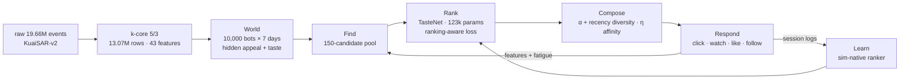

# DOOMSCROLL

> Behaviour-aware short-video recommendation. We model interaction intent, session dynamics, and retention drivers on KuaiSAR-v2 — then rank for what actually keeps people watching.

**19.66M events · 25,877 users · 6.89M items · 19.1 days · 38 categories · 43 leakage-free features · strictly temporal splits**

Feed is 84.5% of volume. Search is 15.5%. Only **~5% of events carry high-intent signal**. Everything in this repo is built around that imbalance.

```text
raw 19.66M (14.61M feed + 5.06M search) → cleaned 19.62M (99.75% kept, 48,257 exact dups dropped)
→ modelled 13.07M after 5/3 k-core (66.6% events, ~100% users, 18.9% items)
→ train 2.73M / val 1.51M / test 1.34M — temporal, no leakage
```

---

## The EDA in 30 seconds

If you read nothing else, read these six plots. They dictate every modelling decision below.

### 1. Clicks are cheap. Intent is rare.


Tier 0 (no engagement): **51.82% · 6.77M**. Tier 1 (click): **43.24% · 5.65M**. Tier 2 (search-click + long-view): **2.00% · 261K**. Tier 3 (like): **2.34% · 305K**. Tier 4 (follow/forward): **0.59% · 77K**.

Weights: click 1.0 · long-view 2.0 · like 3.0 · forward 4.0 · follow 5.0 · hate −3.0 · search-click +2.0 bonus, min tier 2. Mean tier-4 score: **6.42**.

**Takeaway:** binary "positive" labelling dumps 95% noise + 5% gold into one bucket. We rank on graded `label_tier` with tier-derived NDCG gains. `label_pos` stays only as an equal-weight baseline.

Funnel behind it — feed click **53.79%** → like **3.00%** → follow **0.41%** → forward **0.31%**. Conditional on click: like **~4.0%**, follow **~0.55%**, forward **~0.42%**. Likes barely co-occur with follows/forwards — they're distinct intents, not a single scale. Full breakdown: `03_action_rates.png`, `03_action_cooccurrence.png`, `03_tier_by_source.png`.

### 2. No single feature works. Habit + affinity does.


Top-20 single-feature ROC-AUC, bars from 0.5 = chance. Left: per-feature. Right: signal strength `|AUC − 0.5|` by group.

- Any engagement: `u_pos_rate` **0.683** · `u_rate_click` **0.682** · `u_mean_score` **0.661** · `u_play_ratio` **0.627**
- Strong engagement: `u_rate_like` **0.832** · `u_mean_score` **0.784** · `u_pos_rate` **0.626**
- Inverse signal: `ctx_is_search` **0.407 / 0.437** (search impressions click less often but mean higher intent — hence the tier bonus, not a penalty)
- Affinity: `uc_lift` **0.567 / 0.558**, `uc_decay_share` monotone across deciles

Group ranking: **user > user-category > item > context > user-item > cold**. No lone winner → 43-feature set combining habit, affinity, quality, context. Response curves are monotone for `uc_decay_share`, `uc_lift`, `u_pos_rate`, `i_pos_rate` — clean for GBDTs. `ui_prior_n` goes flat then drops = repeat fatigue. Details: `03_feature_deciles.png`, `03_interest_representation.png`.

### 3. Activity is brutalist inequality. Personalize or die.

<p align="center">
  
</p>

Events/user (log10) is broad and unimodal. Median: **223 events/user**. Active days peak at 3–4, tail to 20. Lorenz Gini **0.63** — top 1% users = **12.0%** of events, top 10% = **47.9%**.

**Takeaway:** global estimators collapse. Every model input is user-normalized (`u_pos_rate`, `u_mean_score`, per-action rates) + personalized priors. No exceptions.

### 4. Exposure ≠ quality. Popularity is a coverage hack, not a ranker.

<p align="center">
  
</p>

Rank-frequency is log-log linear long-tail. Exposure Gini **0.55** — top 1% items take **20.3%** of all impressions. But log-exposure vs. engagement rate correlation is only **0.128** (items ≥20 events). Median **5 events/item**, density **0.03656%**.

**Takeaway:** popularity buys coverage, fails on niche relevance. Corrected with item quality priors (`i_pos_rate`, `i_mean_score`, `i_play_ratio`) + novelty control + category fallback. k-core keeps only **18.9%** of items — the tail you filter is the tail you serve, so cold-item path is mandatory (see §6).

### 5. Prime time drives volume. Midday drives efficiency.


- Volume peaks **20–21h**, weekday×hour max at **19–21h**. Weekends spread flatter across daytime.
- Engagement rate peaks **~12–13h (~55%)** + secondary **18–19h**, craters to **~23% at 03–04h**. Overnight 00–05h is tier-0 dominated.
- Daily: feed stabilizes ~0.5–0.6M/day, aggregate engagement climbs **40% → 59%** over window. Weekend **48.80%** vs weekday **47.90%** — basically flat, hour matters more than day.

**Takeaway:** `ctx_hour` + cyclic sin/cos + weekend flag = free contextual lift. Rank differently at noon vs. midnight.

Sessions (30-min gap, 20K-user sample): **~430K sessions, median 8 events / 4.2 min**. Engagement by length: 1 evt **19.1%** → 2–3 **28.2%** → 4–10 **36.8%** → 11–30 **45.6%** → 31–100 **51.6%** → 100+ **49.9%**. First impressions decide whether the session lives. Figure: `03_sessions.png`.

### 6. Search is the cheat code for feed ranking.


Search = 15.5% of events, **97.4%** of users have ≥1 search. Opposite clocks: search peaks **03–05h**, feed peaks **20–21h** — different contexts, same user.

Feed engagement conditioned on same-category history:

| prior feed eng. | prior search | feed eng. rate | mean tier |
|---|---|---|---|
| No | No | 49.31% | 0.56 |
| No | **Yes** | **55.63%** | **0.66** |
| Yes | No | 54.74% | 0.62 |
| Yes | **Yes** | **64.30%** | **0.75** |

**+6–10pp lift** from same-category search, every time. That's why search-derived features + the +2.0 search bonus survive. Search logs click-only — zeros for like/follow/forward mean *unlogged*, not negative. Handled via `schema.json: observed_by_source`.

Watch-time backs it up: median watch ratio **0.218**, bimodal (skip-spike near 0, completion-spike near 1.0), tier-0 median ~0 vs tier-1+ **~0.7–0.9**, play-ratio↔intent correlation **0.331**. Short videos complete more, long videos engage more. Dense signal where discrete actions are sparse (~3% likes). Figure: `03_watch_behaviour.png`.

Repeat kills: 0 priors **52.04%** → 1 prior **15.22%** → 2 priors **10.57%** → 3+ priors **4.09%**. Category novelty decays **28% (day 0) → 16% (days 1–2) → ~1% (day 10+)**, median **2.4%**. Recency is non-monotonic → exponential decay (3-day half-life, 7-day lookback), not linear. Downweight seen items hard. Figure: `03_repeat_novelty_recency.png`.

Categories (38): #39 leads at **~1.35M events**, but high exposure ≠ high engagement (bubble: x = exposure share, y = engagement rate, size = users, color = mean intent). Users are broad — entropy **~4 bits**, median **20 engaged categories**, top-category share only **~0.21**. Exploit + diversify. Figures: `03_category_overview.png`, `03_category_action_heatmap.png`, `03_interest_concentration.png`.

### 7. Evaluation is hostile by design — 45% cold items.


| split | rows | pos rate | strong rate | search % | cold user | cold item | cold user-cat |
|---|---|---|---|---|---|---|---|
| train | 2.73M | 50.76% | 3.06% | 12.27% | 0.14% | 47.44% | 4.89% |
| val | 1.51M | 48.17% | 2.82% | 11.24% | 0.62% | 46.29% | 4.11% |
| test | 1.34M | 51.38% | 3.05% | 8.01% | 3.30% | 44.79% | 13.20% |

Label-tier mix is stable → no target drift. User cold-start is trivial; **item cold-start is the whole game**. No memorizing item IDs — fallback is category affinity + item quality priors + exploration. Cohorts/DAU stable over the 19-day window: enough for habit + session extension, not for long-term churn. Figures: `03_cohorts.png`.

> Full gallery: **22 PNGs in [`eda/figures/`](eda/figures/)** — every claim above traces to a committed figure. Notebooks are source of truth.

---

## Mini-Feed — the engine that ranks the feed

**One line:** a calibrated 10,000-bot user simulator plus a **Find → Rank → Compose → Learn**
serving stack, evolved to **59% of the personalized-oracle gap** — every rung verified by a paired
per-bot bootstrap, every rejection recorded with its measured cost. The offline ranker itself was
lifted from 0.4961 → **0.5006** val NDCG@10 (test +0.0049) by a bigger net plus a ranking-aware loss.



The same 10,000 bots, schedules and random draws are replayed per policy (common random numbers),
so the ladder is a paired experiment, not a zoo of sim runs.


| policy | IWE / bot | oracle gap closed | promotion (95% CI) |
|---|---|---|---|
| random | 61.86 | 0 | baseline |
| popularity | 77.87 | 0.11 | +16.0 [+15.3, +16.7] |
| personal_affinity | 93.64 | 0.21 | +15.8 [+14.1, +17.4] |
| taste (learned ranker) | 120.26 | 0.39 | +26.6 [+24.0, +29.3] |
| taste_composer | 140.44 | 0.52 | +20.2 [+18.9, +21.5] |
| **evolved (ES over 18 knobs)** | **151.53** | **0.59** | **+11.1 [+9.9, +12.4]** |
| oracle | 213.10 | 1.00 | greedy ceiling |

Engagement never bought its keep by collapsing diversity: coverage 77 → 81%, category entropy
3.08 → 3.33 bits, repeat-exposure *down* 0.6 → 0.4%. More figures:
[`notes/figures/`](notes/figures/) — generations `02`, calibration `03`, cohort headroom `04`,
return curves `05`.

### Three-command quickstart

```bash
cd recommender-engine
P=~/miniconda3/envs/picograd/bin/python
$P run_offline.py --fast        # offline TasteNet + graded NDCG
$P run_improve.py --test baseline_masked,wide_hybrid   # ranking-aware loss beats baseline (~12 min)
$P run_swarm.py                 # the ladder (~2 min) incl. evolved
$P run_evolve.py                # (1+λ)-ES -> config/policy_evolved.yaml
$P -m pytest -q                 # 35 tests
```

Figures: `$P -m feed.plotting`. End-to-end executed notebook: [`demo.ipynb`](demo.ipynb). Pretrained
checkpoints are published in [`recommender-engine/weights/`](recommender-engine/weights/). Full run
sheet and per-phase write-ups: [`recommender-engine/`](recommender-engine/), [`notes/`](notes/),
[`status.md`](status.md), [`notes/phaseA.md`](notes/phaseA.md).

### What didn't work (kept on purpose)

| idea | measured fate |
|---|---|
| seen-penalty γ | −0.01 [−0.66, +0.64] — redundant with the hard within-session dedup |
| cold-item bonus β | −1.04 [−2.21, +0.13] — cold-start needs a real exploration story, not a bonus |
| ε-greedy exploration | −2.34 [−3.00, −1.67] and repeat-exposure guardrail +21% worse |
| recency-weighted diversity alone | +1.31 IWE but a guardrail degraded → rejected; only the joint `α 0.5 + recency 0.85` retune survived (+1.10 [+0.16, +2.04]) |
| length-adaptive diversity alone | −5.70 [−6.70, −4.69] — stiffening the penalty with session length collapses IWE |
| raw capacity (wide / wide_deep / cross) | ≈ neutral under BCE (−0.0012 to −0.0017); the ranking-aware objective, not more params, is what helps |
| hour-trough / repeat ×2–×3 calibration | structural model-form limits, documented in [`notes/calibration.md`](notes/calibration.md) |

**Honesty clause:** the simulator is hand-designed and calibrated to marginals only (7/12); absolute
IWE is not a claim about real users — all results are **relative**, under stated assumptions, with
guardrails and CIs attached.

---

## What we built from it

**Pipeline:** `01_load_and_clean` → `02_preprocess_and_features` → `03_eda`. Strict order. Raw data git-ignored, artefacts in `data/`.

- **01 — Load & clean.** Pattern-matched discovery, 5-row schema probe, canonical column resolution. ~1436 MB resident for 19.66M rows (reduced int dtypes, categorical source). Conservative clean: **99.75% retained**. Only row-drop is exact dups. Flags binarized (click>1 in 0.155% → 1; high-intent-without-click 0.813% kept, no fake clicks — feed likes don't need detail clicks), `play_ratio` clipped 0–5, non-positive duration 2.691% → NaN. Zero null keys, zero bad timestamps. No bot filtering — 3 users >24,913 events kept + reviewed. Figures: `01_raw_volume_and_prevalence.png`, `01_cleaning_summary.png`.
- **02 — Intent + features + splits.** One config block: tiers, weights, search bonus, 3-day half-life, 7-day lookback, splits 0.50/0.70/0.85, k-core 5/3, UTC+8, seed 42. Iterative k-core → per-event `tier/score/neg/pos/is_search` → time axis (`t`, `day`, `hour`, `dow`, cuts c1/c2/c3) → **rolling as-of splits from history only** (train labels [c1,c2) ~3.87d, val/test ~2.91d each) with assertion guards. **43 features**, zero NaNs, labels never in features: `u_*` habit (counts, rates, recency, watch) · `uc_*` affinity (decayed scores, exposure/decay share, lift = decay/exposure, repeat, recency) · `i_*` quality · `ui_*` memory · `ctx_*` time/source · `cold_*` fallbacks · `cat_id`. Outputs: `events_enriched.parquet`, `features_{train,val,test}.parquet`, `user_interest.parquet`, `feature_dictionary.csv`, `id_maps_*`, `preprocess_config.json`. Figures: `02_tier_distribution.png`, `02_feature_correlation.png` (Spearman block structure, no perfect collinearity — scale/encode in pipeline, fit on train only).
- **03 — EDA.** 15 sections, 1M-event + 20K-user samples (seed 42) for heavy plots, full data for tables. All outputs `03_*.png`.

**Feature groups (43 total — see `data/processed/feature_dictionary.csv`):**
`u_n_events, u_n_items, u_active_days, u_mean_score, u_pos_rate, u_search_share, u_recent24, u_n_cats, u_recency, u_play_ratio, u_rate_{click,like,follow,forward}` · `uc_n, uc_items, uc_pos, uc_score, uc_decay, uc_exposure_share, uc_decay_share, uc_lift, uc_repeat, uc_recency` · `i_n, i_users, i_mean_score, i_pos_rate, i_duration, i_play_ratio` · `ui_prior_n, ui_prior_max_tier, ui_prior_score` · `cold_user, cold_item, cold_uc` · `ctx_hour, ctx_dow, ctx_is_search, ctx_hour_sin/cos, ctx_is_weekend` · `cat_id`

---

## Design rules the EDA forced

1. **Graded intent, not binary clicks.** Tiers 0–4 + watch ratio. NDCG@k with tier gains. Equal-weight = baseline only.
2. **Habit + affinity over popularity.** `u_pos_rate`, `u_mean_score`, `uc_lift`, `uc_decay_share` are monotone and transfer. Popularity = coverage.
3. **Time is free signal.** Hour/weekend encodings stay. Noon ≠ midnight.
4. **Novelty or death.** Repeat penalty + 3-day exponential decay + 7-day lookback, fixed across splits.
5. **Search → feed transfer.** Keep search features + bonus. +6–10pp is not noise.
6. **Cold-item path is P0.** ~45% unseen/split. Category priors + quality estimates + exploration.
7. **Beat real baselines.** Global popularity, personalised popularity, equal-weight — per-user ranking of label-window impressions, plus coverage/diversity/novelty. Product BAR: longer sessions, more return visits, more high-intent actions per active hour.

---

## Reproduce

```text
data/raw/       <- KuaiSAR-v2 CSVs, git-ignored
data/interim/   <- notebook 01: events.parquet, items.parquet, users.parquet, schema.json, cleaning_report.csv
data/processed/ <- notebook 02: events_enriched.parquet, features_{train,val,test}.parquet, ...
eda/figures/    <- 22 committed PNGs
```

```bash
pip install pandas numpy matplotlib seaborn scikit-learn pyarrow jupyterlab
jupyter lab
# run in order:
# eda/01_load_and_clean.ipynb
# eda/02_preprocess_and_features.ipynb
# eda/03_eda.ipynb
```

Rules: 03 needs 01+02 artefacts. 01 writes only to `data/` + `eda/figures/`. Unlogged actions are 0 — check `schema.json: observed_by_source` before cross-source compares. All scaling/encoding fit on train only.

---

## Structure

```text
doomscroll/
  eda/
    01_load_and_clean.ipynb          <- raw → canonical event table
    02_preprocess_and_features.ipynb <- tiers, splits, 43 features
    03_eda.ipynb                     <- behavioural analysis, all figures
    figures/                         <- 22 PNGs, embedded above + linked
  recommender-engine/                <- simulator + Find→Rank→Compose→Learn engine (Phases 0–4)
    feed/                            <- world, swarm, policies, composer, evolve, plotting
    artifacts/  models/  tests/  config/
  notes/                           <- phase write-ups + figures/ (the 5 headline PNGs)
  data/raw|interim|processed         <- ignored, see Reproduce
  status.md                          <- phase-by-phase build log, done vs left
```

## Roadmap

- Shipped: EDA (22 figures) + the full engine pipeline Phases 0–5 — see [`status.md`](status.md).
- Next: a real cold-start P0 (the ε/β story needs an actual exploration process, not a bonus) ·
  EDA extensions: per-category retention curves · creator concentration · query→category transfer.

## Limitations

- 19 days → short-term habit + session extension, not long-term churn.
- Logged interactions ≠ full scroll telemetry — gaps/sessions approximate.
- Search logs clicks only — zeros elsewhere are missing, not negative.
- k-core drops 81% of items from training — serving tail needs fallback.
- Univariate AUC = viability, not multivariate proof — interactions come from the ranker.

---

## License & provenance

MIT — see `LICENSE`. Data: KuaiSAR-v2, research use, never committed. Notebooks are source of truth for the data layer; the engine is code-first (`feed/` + configs + tests). Status: **EDA complete · engine Phases 0–4 shipped · Phase 5 (ship polish) complete — see [`status.md`](status.md)**.
